<picture>
  <source media="(prefers-color-scheme: dark)" srcset="./assets/source-dark.svg" />
  
</picture>

Over **4+ years**, I've owned end-to-end delivery of NPI launches, ERP transformations, 3PL integrations, and inventory optimization initiatives across global operations. When I'm not shipping programs, I'm building tools in Rust, TypeScript, and Dart.

```ts
const gayathri: Engineer = {
  name: "Gayathri Gurram",
  role: "NPI & Supply Chain Program Manager",
  company: "Athena Cosmetics",
  location: "United States",
  yearsShipping: 6,
  languages: ["SQL", "Rust", "TypeScript", "Dart", "Python", "JavaScript"],
  stack: ["Agile Methodology", "SAP S/4HANA", "Oracle Fusion", "Microsoft Dynamics Business Central", "Navision", "Power BI", "Tableau", "Advanced Excel"],
  career: [
    { at: "Athena Cosmetics", role: "Program Manager", when: "Jan 2025 – Present" },
    { at: "Doublene USA", role: "Associate Program Manager", when: "Feb 2024 – Dec 2024" },
    { at: "TheSmartBridge", role: "Supply Chain Product Analyst", when: "Apr 2020 – Jul 2022" },
  ],
  education: "Master of Science in Information Systems, University of Maryland, Baltimore",
};
```

## `projects.map(explain)`

<details>
<summary><code>projects.quarry()</code> Vectorized SQL query engine over Apache Arrow</summary>

Built from scratch in Rust: parser, binder, rule-based optimizer with join reordering, hash join and aggregate, checked against SQLite.

</details>

<details>
<summary><code>projects.receiptLens()</code> Privacy-first Flutter receipt scanner</summary>

On-device OCR and TFLite line-item classifier with fully local encrypted storage and CSV/QuickBooks export. Built with Dart, Flutter, Google ML Kit, Drift (SQLite), and Riverpod. No cloud upload in the core flow.

</details>

<details>
<summary><code>projects.oneSpec()</code> One JSON Schema compiles into three validated layers</summary>

Generates TypeScript types, client and server validators (Ajv), and PostgreSQL check constraints from a single source. Property-based tests proving all three layers agree.

</details>

<details>
<summary><code>projects.dmarcWatch()</code> Email deliverability monitoring from DMARC reports</summary>

Parses DMARC aggregate XML reports to separate mail that never arrived from mail that arrived and was ignored. Flags unauthorised senders and tracks SPF/DKIM alignment. Built with TypeScript and tested with node:test.

</details>

<details>
<summary><code>projects.strideDiff()</code> Architecture-as-code threat modeling in CI</summary>

Computes a STRIDE threat delta on every pull request and fails CI when a new trust-boundary crossing has no recorded mitigation. Parses YAML threat models, builds Mermaid diagrams, and enforces security decisions in code review. Built with TypeScript, Zod, and Vitest.

</details>

<details>
<summary><code>projects.axeBudget()</code> Accessibility regression gate for CI</summary>

Freezes existing WCAG violations into an expiring debt ledger and fails CI only on new violations or budget overruns. Integrates with Playwright, Storybook, and axe-core.

</details>

## `CHANGELOG.md`

### v4.0 · Athena Cosmetics

*Jan 2025 – Present*

- **$2M** global packaging programs across three fulfillment centers in North America, Italy, and Netherlands, coordinating six stakeholders across Finance, Operations, Supply Chain, and Ecommerce
- **Improved** packaging obsolescence by **7%** and reduced excess inventory **15%** through SQL and Power BI forecasting, inventory optimization, and ERP enhancements supporting **10K+** records
- **Added** KPIs and Power BI dashboards that improved inventory visibility, fulfillment performance, and forecasting accuracy across multi-region operations

### v3.0 · Doublene USA

*Feb 2024 – Dec 2024*

- **Improved** order accuracy **20%** by automating weekly Excel-based supply chain reporting workflows, reducing processing time from five hours to less than ten minutes
- Reporting requirements, business processes, and functional specifications supporting **$3.5M** feedstock programs and launch readiness
- Reduced revenue-impacting delays **18%** through analysis of production, inventory, and demand-planning requirements supporting decisions

### v2.0 · TheSmartBridge

*Apr 2020 – Jul 2022*

- **Improved** process efficiency **12%** by developing SQL and Power BI dashboards for KPI monitoring and performance insights
- **Improved** supplier lead times **15%** and contributed to **10%** cost reduction through procurement and supplier-performance analyses
- Consolidated operational reporting to improve visibility into sales, operations, demand, and capacity-planning performance

## `npm ls --depth=0`

<p align="center">
  
</p>

## `contact()`

[`email`](mailto:ggurram.work@gmail.com) · [`linkedin`](https://linkedin.com/in/gayathri-g-b86207348/) · [`github`](https://github.com/GG-25)

## Projects

- [quarry](https://github.com/GG-25/quarry) — Vectorized SQL query engine over Apache Arrow written from scratch in Rust: parser, binder, rule-based optimizer with join reordering, hash join and aggregate…
- [receiptlens](https://github.com/GG-25/receiptlens) — A privacy-first Flutter receipt scanner: on-device OCR and a TFLite line-item classifier with fully local encrypted storage and CSV/QuickBooks export, with no…
- [metricdiff](https://github.com/GG-25/metricdiff) — Diff two snapshots of your metrics and fail the build when something moves too much.
- [onespec](https://github.com/GG-25/onespec) — One JSON Schema compiles into TypeScript types, client and server validators and PostgreSQL check constraints, with property-based tests proving all three…
- [dmarcwatch](https://github.com/GG-25/dmarcwatch) — Email deliverability monitoring that parses DMARC aggregate XML reports to separate mail that never arrived from mail that arrived and was ignored, and flags…
- [sparkline](https://github.com/GG-25/sparkline) — Zero-dependency, accessible SVG sparklines — as a framework-agnostic function and a custom element.
- [adrlint](https://github.com/GG-25/adrlint) — A decision-record linter that builds a graph of architecture decisions and flags unresolved contradictions, expired reviews and orphaned supersedes chains.
- [axebudget](https://github.com/GG-25/axebudget) — An accessibility regression gate that freezes existing WCAG violations into an expiring debt ledger and fails CI only on new violations or budget overruns.
- [stridediff](https://github.com/GG-25/stridediff) — Architecture-as-code tool that computes a STRIDE threat delta on every pull request and fails CI when a new trust-boundary crossing has no recorded mitigation.
- [niceaxis](https://github.com/GG-25/niceaxis) — The axis math every chart reinvents — as a tiny, pure, zero-dependency library.
